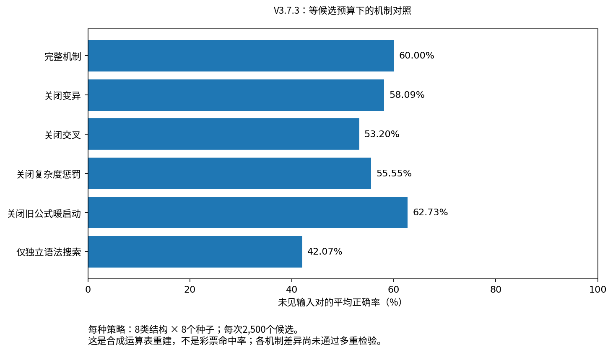

# PL5 V3.7.3：等预算机制贡献实验报告

## 结论

本轮已执行 **480组实验、1,200,000次计费候选评价**，而不是仅制定计划。在指定的八类新合成结构任务中，完整机制的未见输入正确率为60.00%，仅独立语法搜索为42.07%；但四项单机制贡献在按任务汇总、多重检验后均未达到5%显著性标准。不能据此宣布某机制普遍有效或无效。

最值得追查的是旧公式暖启动：关闭它的平均正确率为62.73%，完整机制为60.00%。这是本轮观察，不足以证明普遍负迁移，更不能看到结果后直接宣布“关闭暖启动”为正式最优配置。原默认配置没有根据本轮测试成绩自动改写。

随机对照中，完整机制训练正确率为26.67%，保留正确率为8.75%（56/640；精确95%区间6.68%—11.21%），未出现全表精确重建。这进一步区分了“能拟合训练巧合”和“有未见数据价值”，不构成真实彩票优势或平台整体假发现率保证。

## 1. 数据和预算

每张表的定义域为数字0—9的100个输入对，60格训练、40格保留。八类指定结构中四类与旧公式含相关子结构、四类为其他组合；另设两类独立均匀随机表。每类使用37301—37308八个种子，同一任务与种子下六种策略使用相同训练/保留划分。

总计10类×8种子×6策略=480次拟合。每策略64次结构任务、16次随机对照；每次严格评价2,500个不同的规范化AST。所有480次均达到该预算，没有早停、预算不足或失败试验被排除。这个单位包含算术越界候选的解释器调用，但不重复计算相同AST；它不是等运行秒数、等CPU成本或等表达式节点数。

预注册本地协议（不是第三方时间戳或外部盲测）在拟合前保存。SHA256：

`c453154719afda1d4a6ac9c661d8924b81a10f498bdd5dc4e2f06730774e1a42`

模型选择函数只接收训练单元。每一数据集的六个模型全部冻结并保存后，才评价保留格和全100格真值；未用保留结果调参。最终全表认证使用独立标量解释器。实验仍是开发阶段的已知合成任务，不是未知自然规律或彩票时间序列。

## 2. 消融开关的含义

“关闭变异”不再调用子树变异；“关闭交叉”不再调用子树交叉。被关闭的槽位用不读目标标签的独立语法采样补足预算，而不是少算；因此结果是这种预算再分配方案下的增量贡献，不是某机制的抽象本质。

“关闭复杂度”同时移除数值惩罚与按节点数优先的平局规则。V3.7.2旧排序即使惩罚系数为零仍会偏向短式，本轮没有把那种伪消融当成关闭。共同的树大小上限、代数化简和安全语法仍保留。

“关闭暖启动”不读入四条旧公式作为候选；开启时四条来自V3.7.2已冻结记录，未按新任务标签筛选，且都不与新结构任务整表相同。源任务知识获取成本不包含在本轮2,500预算中，所以这是既有知识库条件下的目标任务边际成本对照，不是端到端迁移经济性证明。

“仅独立语法搜索”关闭全部自适应生成与暖启动，但仍按训练误差与复杂度在独立候选中选优，不能描述成完全不使用训练数据。

## 3. 总体结果

| 策略 | 结构任务未见格正确率 | 全100格精确重建 | 平均表达式节点数 | IID保留格正确数 |
|---|---:|---:|---:|---:|
| 完整机制 | 60.00% | 12/64 | 8.09 | 56/640（8.75%） |
| 关闭变异 | 58.09% | 11/64 | 7.88 | 57/640（8.91%） |
| 关闭交叉 | 53.20% | 8/64 | 7.38 | 55/640（8.59%） |
| 关闭复杂度惩罚 | 55.55% | 11/64 | 9.97 | 68/640（10.62%） |
| 关闭旧公式暖启动 | 62.73% | 16/64 | 8.09 | 57/640（8.91%） |
| 仅独立语法搜索 | 42.07% | 3/64 | 5.69 | 61/640（9.53%） |

这些百分比是64次结构试验的描述性平均；同一结构的多次划分会复用输入格，不能当成64次独立数学发现，更不能把全部保留格作为独立任务样本。六种策略共享随机对照真值，不能跨策略再合并成六倍独立随机样本。



## 4. 机制贡献及不确定性

先在每个结构任务内对八个种子求平均，再对八个任务差值做精确双侧符号翻转检验；对预先指定的四项比较做Holm校正。该诊断依赖任务差值在零假设下符号可交换/对称的假设。八个任务是人为指定且部分相关，不是所有数学任务的随机样本，故p值仅用于开发阶段条件性诊断。

| 比较 | 未见格正确率差 | 原始p值 | Holm校正p值 |
|---|---:|---:|---:|
| 完整机制 − 关闭变异 | +1.91个百分点 | 0.625000 | 1.000000 |
| 完整机制 − 关闭交叉 | +6.80个百分点 | 0.203125 | 0.609375 |
| 完整机制 − 关闭复杂度惩罚 | +4.45个百分点 | 0.046875 | 0.187500 |
| 完整机制 − 关闭旧公式暖启动 | -2.73个百分点 | 0.500000 | 1.000000 |

复杂度项的原始p约0.0469，但校正后为0.1875，不能只报告原始值并宣布显著。交叉的平均贡献约+6.80个百分点，但不同任务方向不一致，校正p约0.6094。变异与暖启动也没有通过校正后的显著性门槛。未显著不等于效果严格为零。

完整机制与独立语法搜索的17.93个百分点差值是描述性结果，未临时加进原四项确认性比较来制造更漂亮的结论。

## 5. 按任务观察

| 任务 | 完整 | 关变异 | 关交叉 | 关复杂度 | 关暖启动 | 独立语法 |
|---|---:|---:|---:|---:|---:|---:|
| 双线性式加常数 | 49.4% | 70.0% | 22.5% | 35.9% | 70.9% | 22.5% |
| 和的平方加常数 | 32.8% | 32.2% | 24.7% | 25.9% | 32.8% | 29.1% |
| 最小值式加常数 | 73.4% | 65.0% | 63.7% | 70.9% | 73.4% | 41.6% |
| 乘积绝对差再加输入 | 42.8% | 41.9% | 54.1% | 37.2% | 42.8% | 28.4% |
| 非对称三次式 | 69.7% | 54.7% | 51.9% | 67.8% | 69.7% | 38.1% |
| 带偏移的最大公约数 | 72.5% | 63.1% | 59.4% | 65.3% | 72.5% | 62.8% |
| 乘积与和值的异或 | 44.1% | 42.5% | 52.5% | 43.1% | 39.7% | 40.6% |
| 平方差的绝对值 | 95.3% | 95.3% | 96.9% | 98.1% | 100.0% | 73.4% |

平方差较容易恢复，和的平方再加常数仍明显困难。这不意味着后者不可学习；本轮只检验特定语法、搜索调度和有限预算。不能把与上一轮不同预算、不同任务下的百分比直接比较成能力退步或提升。

## 6. 软件和证据验收

累计后端 **643/643** 通过；独立目录的桥接/升级集成 **29/29** 通过，合计672项，失败、错误、跳过均为0。新增41项测试包含真实禁用、预算守恒、无复杂度平局偏置、协议和统计样例、CLI拒绝覆盖等。新增生产功能的测试先失败后实现；另有5项审查测试用于反向核对。

所有480组保留成绩和精确重建结果已从落盘冻结算子重新用独立标量解释器计算，并与原表逐项相等。协议中的8个代码指纹仍全部相符。抽取预定的一个结构和一个随机对照、一个种子、六策略，共12组重跑，除耗时外完全一致；它们不算新增独立证据。

对原V3.7.2累计包 **775个文件逐字节校验，全部保持不变**。新增代码位于现有`research_backend/pailie5/`，复用既有AST、证书及冻结对象协议，不是另起一套项目。历史包元数据保留3.7.2；3.7.3是本轮累计科研交付编号，由新入口、协议与`RELEASE_V373.json`标识。

未做：完整React构建、Windows本机部署、GitHub上传、真实股指或彩票开奖验证。现有测试通过也不代表全部历史研究承诺均已被证明。

## 7. 下一项应验证的假设

V3.7.4应研究“有选择的知识迁移”：比较完整旧公式暖启动、可复用子表达式库以及仅用训练期证据决定启用的知识选择器；同时计入知识准备成本。新任务和种子需重新锁定，不能继续用本轮保留集作开发成绩单。

一个待检验的解释是：旧公式的输出与新任务不相同，却含有可复用片段；直接把整式投入竞争，可能无法有效保留这些片段。此处仅提出解释，不把它当成已经识别的因果机制。

## 8. 可复现入口与方法参考

在完整累计包的`research_backend`目录：

```bash
python research_v373.py --output ../runs/v373_reproduction --budget 2500
python -m pytest -q
```

输出目录必须不存在，避免覆盖实验。精确原始记录在`benchmark/results.json`，每组有冻结算子和结果，80个数据集各有训练、保留与真值文件。`scripts/independent_verify.py`独立复核本交付中的主实验和重跑子集。

方法参考（不作为本次结果的外部背书）：La Cava等的SRBench强调透明可复现的符号回归基准；SciPy `binomtest`用于IID对照的精确二项检验和区间。
- https://datasets-benchmarks-proceedings.neurips.cc/paper/2021/hash/c0c7c76d30bd3dcaefc96f40275bdc0a-Abstract-round1.html
- https://docs.scipy.org/doc/scipy/reference/generated/scipy.stats.binomtest.html
